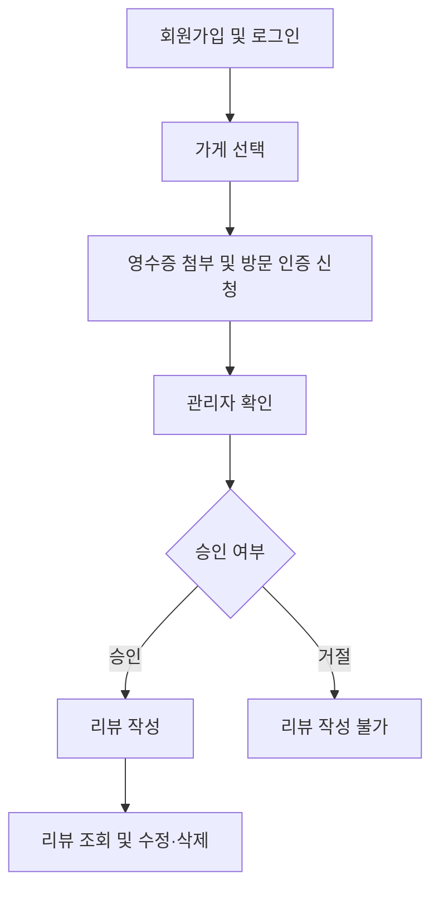
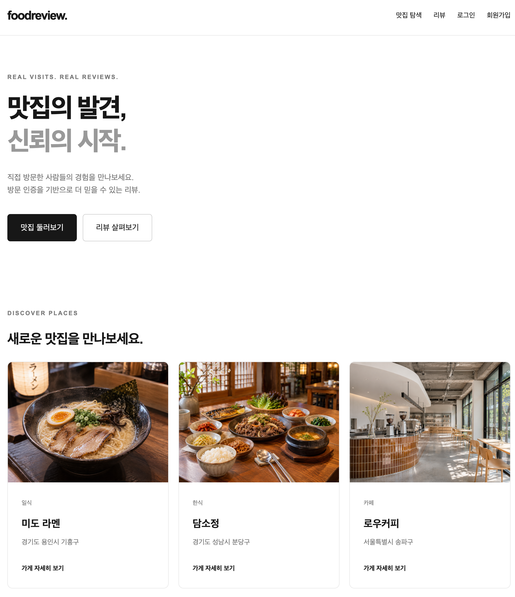
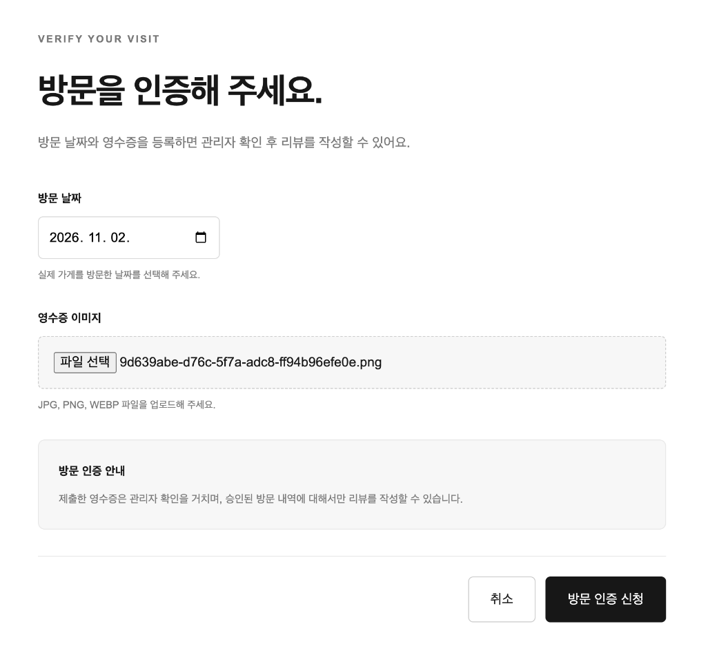
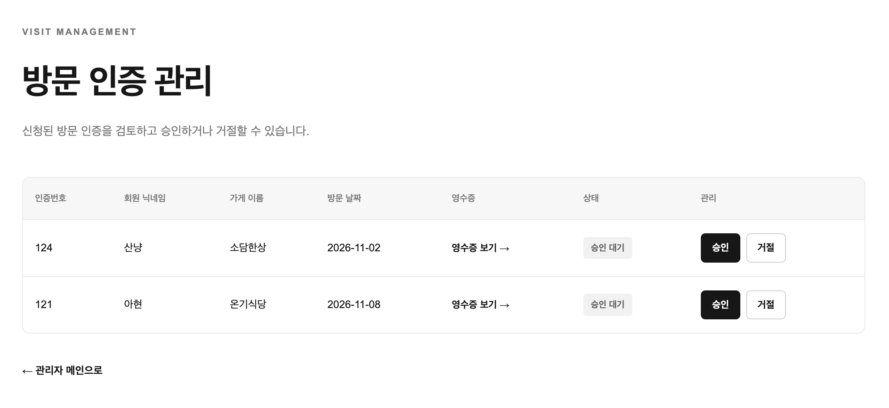
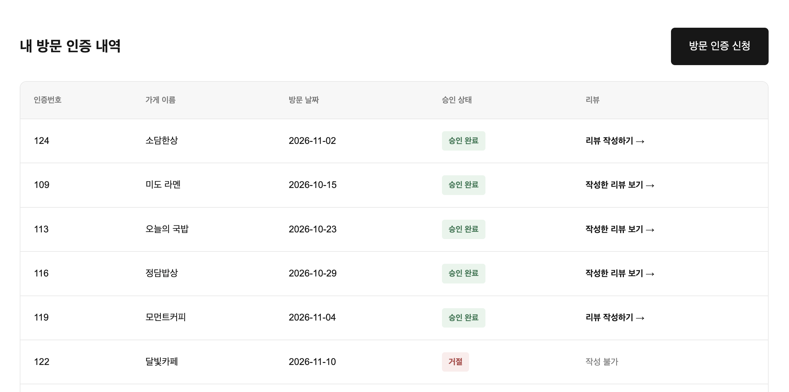
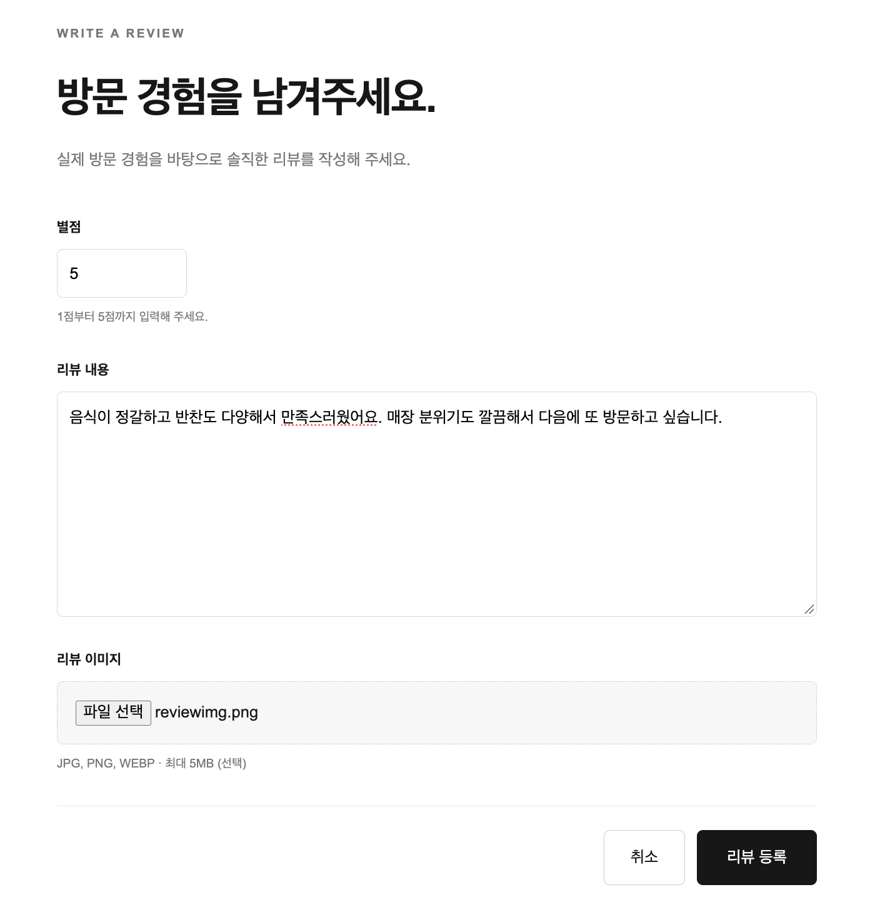
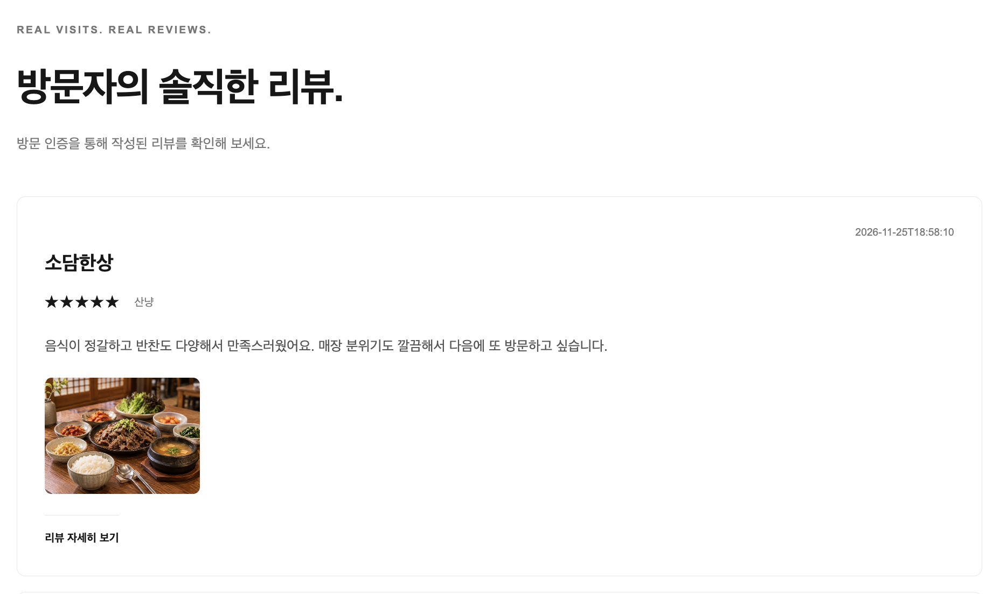

<div align="center">

# foodreview.

### 맛집의 발견, 신뢰의 시작.

방문 인증 기반 맛집·카페 리뷰 서비스

`개인 프로젝트` · `Backend Development`

</div>

---

## 📖 프로젝트 소개

방문 인증을 승인받은 회원만 리뷰를 작성할 수 있는 맛집·카페 리뷰 서비스입니다.

Spring Boot, MyBatis, MySQL을 활용하여 단순한 게시판 CRUD를 넘어 방문 인증, 관리자 승인, 리뷰 작성 자격 등 기능 간의 비즈니스 규칙을 구현했습니다.

### 핵심 규칙

- 관리자가 승인한 본인의 방문 기록으로만 리뷰 작성
- 방문 인증 1건당 리뷰 최대 1개
- 본인이 작성한 리뷰만 수정·삭제
- 관리자 권한을 가진 회원만 관리자 기능 이용

## 🛠 Tech Stack

**Backend**


**Database**


**Frontend**


**Build & Test**


**Version Control**


## 🔄 Service Flow



## 💻 주요 기술 구현

### 01. 리뷰 작성 자격 및 소유권 검증

로그인 여부뿐만 아니라 회원 번호, 방문 인증 번호, 승인 상태를 함께 확인하여 리뷰 작성 자격을 검증합니다.

리뷰 수정·삭제 시에도 기존 리뷰가 로그인한 회원의 것인지 확인합니다.

### 02. 중복 리뷰 등록 방지

방문 인증 1건당 리뷰를 하나만 작성할 수 있도록 두 단계에서 검사합니다.

- 서비스에서 등록 전 기존 리뷰 존재 여부 조회
- DB의 `review.vno` 컬럼에 UNIQUE 제약조건 적용

사전 조회를 통해 중복 등록 여부를 확인하고, 데이터베이스 제약조건으로 중복 저장을 방지합니다.

실제 MySQL 연동 환경에서 중복 등록 요청 시 HTTP 409가 반환되고 리뷰가 중복 저장되지 않는 것을 확인했습니다.

### 03. 방문 인증 상태 관리

| 상태값 | 상태 | 리뷰 작성 |
| :---: | :---: | :---: |
| 0 | 승인 대기 | 불가 |
| 1 | 승인 완료 | 가능 (미작성 시) |
| 2 | 거절 | 불가 |

승인 대기 상태인 방문 인증만 처리하도록 조건부 UPDATE를 적용했습니다.

```sql
UPDATE visit
SET status = 1
WHERE vno = #{vno}
  AND status = 0
```

이미 처리되었거나 존재하지 않는 방문 인증은 변경된 행이 없으므로 관리자 API에서 HTTP 409를 반환합니다.

### 04. 인증 및 인가

- BCrypt를 사용한 비밀번호 해싱
- 세션 기반 로그인 관리
- `LoginInterceptor`를 통한 로그인 및 회원 활성 상태 확인
- 비활성 회원의 세션 무효화
- `AdminInterceptor`를 통한 관리자 접근 제한

### 05. 이미지 파일 관리

영수증과 리뷰 이미지는 로컬 파일 시스템에 저장하고, DB에는 파일명을 저장합니다.

- 파일 크기 5MB 제한
- 이미지 확장자 및 파일 헤더 검사
- UUID 기반 파일명 생성
- 리뷰 이미지 교체·삭제 시 기존 파일 정리
- 리뷰 DB 등록 실패 시 새로 저장한 이미지 삭제 처리

### 06. 리뷰 검색 및 페이징

리뷰 조회 REST API에서 MyBatis를 사용해 키워드 검색과 별점 필터를 적용합니다.

- 키워드 및 별점 복합 조건 검색
- 별점 범위: 1~5
- 페이지당 10개 조회

## 📸 서비스 화면

> 아래 화면은 테스트 데이터와 예시 이미지를 사용한 로컬 실행 화면입니다.

### 메인 화면

<div align="center">

</div>

### 방문 인증 및 관리자 승인

<table>
  <tr>
    <th width="50%">방문 인증 신청</th>
    <th width="50%">관리자 방문 인증 관리</th>
  </tr>
  <tr>
    <td></td>
    <td></td>
  </tr>
  <tr>
    <td>방문 날짜와 영수증 이미지 등록</td>
    <td>신청 내역 확인 및 승인·거절</td>
  </tr>
</table>

### 방문 인증 상태 확인

<div align="center">

</div>

방문 인증 상태와 기존 리뷰 작성 여부에 따라 리뷰 작성 가능 여부가 달라집니다.

### 리뷰 작성 및 등록

<table>
  <tr>
    <th width="50%">리뷰 작성</th>
    <th width="50%">리뷰 등록 결과</th>
  </tr>
  <tr>
    <td></td>
    <td></td>
  </tr>
  <tr>
    <td>별점, 리뷰 내용 및 이미지 등록</td>
    <td>등록된 리뷰 조회</td>
  </tr>
</table>

## 📐 ERD

<div align="center">

</div>

| 테이블 | 설명 |
| --- | --- |
| `member` | 회원 정보 |
| `place` | 맛집·카페 정보 |
| `visit` | 방문 인증 정보 |
| `review` | 리뷰 정보 |

- member : visit = 1 : N
- place : visit = 1 : N
- visit : review = 1 : 0..1

초기 테이블 생성 SQL: [`database/schema.sql`](database/schema.sql)

## 📡 REST API

| Method | Endpoint | 설명 | 권한 |
| --- | --- | --- | --- |
| GET | `/api/reviews` | 리뷰 검색 및 페이징 | 전체 |
| POST | `/api/reviews` | 리뷰 등록 | 로그인 회원 |
| PATCH | `/api/admin/visits/{vno}/approve` | 방문 인증 승인 | 관리자 |
| PATCH | `/api/admin/visits/{vno}/reject` | 방문 인증 거절 | 관리자 |

### 리뷰 조회 요청 예시

```http
GET /api/reviews?keyword=행복카페&rating=5&page=1
```

| Parameter | 설명 |
| --- | --- |
| keyword | 검색어 |
| rating | 별점 (1~5) |
| page | 페이지 번호 |

### 주요 응답 코드

| Status | 설명 |
| :---: | --- |
| 200 | 요청 성공 |
| 201 | 리뷰 등록 성공 |
| 401 | 인증 필요 |
| 409 | 중복 리뷰 또는 처리할 수 없는 방문 인증 |

## 🧪 테스트 및 검증

### 자동화 테스트

JUnit 5와 Mockito를 사용했습니다.

- 관리자 방문 인증 승인·거절 성공 및 실패
- 리뷰 REST API 요청 및 응답
- 로그인 인터셉터

### 실제 MySQL 연동 검증

- 리뷰 등록 및 DB 저장 확인
- 중복 리뷰 등록 시 HTTP 409 응답 및 중복 저장 방지
- 리뷰 페이징 조회
- 키워드 검색 및 별점 필터
- 검색어와 별점 복합 필터
- 신규 DB에서 테이블 생성 스크립트 실행

```bash
bash gradlew test
```

## 📌 한계 및 개선 계획

현재 로컬 환경에서 개발 및 검증을 진행했습니다.

- 서버 배포 및 배포 환경 검증
- 동시 요청 테스트 추가
- 파일 시스템 오류 상황에 대한 검증
- 자동화 테스트 범위 확대

## 🚀 실행 방법

<details>
<summary><b>프로젝트 실행 방법 펼치기</b></summary>

### 실행 환경

Java 17, MySQL 8, Git

### 1. 프로젝트 다운로드

```bash
git clone https://github.com/ahyun00/foodreview.git
cd foodreview
```

비공개 저장소인 경우 접근 권한이 필요합니다.

### 2. 데이터베이스 생성

MySQL에 연결한 후 `database/schema.sql`을 실행합니다.

신규 데이터베이스 초기화용 스크립트이며, 기존 테이블이 존재하는 환경에서는 중복 실행하지 않습니다.

### 3. 데이터베이스 연결 설정

`src/main/resources/application.properties` 파일을 생성합니다.

```properties
spring.application.name=foodreview

spring.datasource.url=jdbc:mysql://localhost:3306/foodreview
spring.datasource.username=YOUR_DB_USERNAME
spring.datasource.password=YOUR_DB_PASSWORD

mybatis.mapper-locations=classpath:mapper/**/*.xml
mybatis.configuration.map-underscore-to-camel-case=true

spring.servlet.multipart.max-file-size=5MB
spring.servlet.multipart.max-request-size=10MB
```

DB 사용자 이름과 비밀번호는 각자의 접속 정보로 변경합니다.

실제 DB 접속 정보는 GitHub에 포함하지 않습니다.

### 4. 애플리케이션 실행

```bash
bash gradlew bootRun
```

브라우저에서 http://localhost:8080 으로 접속합니다.

### 5. 관리자 계정 설정

회원가입 후 해당 계정의 권한을 ADMIN으로 변경합니다.

```sql
UPDATE foodreview.member
SET role = 'ADMIN'
WHERE email = 'admin@example.com';
```

이메일은 직접 가입한 테스트 계정의 이메일로 변경하고 다시 로그인합니다.

### 6. 가게 테스트 데이터 등록

```sql
INSERT INTO foodreview.place
    (name, category, address, phone, description)
VALUES
    ('테스트카페', '카페', '테스트 주소',
     '000-0000-0000', '기능 검증용 가게');
```

### 7. 이미지 저장 경로

- 영수증 이미지: `uploads/receipts/`
- 리뷰 이미지: `uploads/reviews/`

이미지는 애플리케이션 실행 디렉터리를 기준으로 로컬 파일 시스템에 저장됩니다.

업로드된 사용자 이미지는 GitHub에 포함하지 않습니다.

</details>

---

<div align="center">

**FoodReview**

Real visits. Real reviews.

</div>
