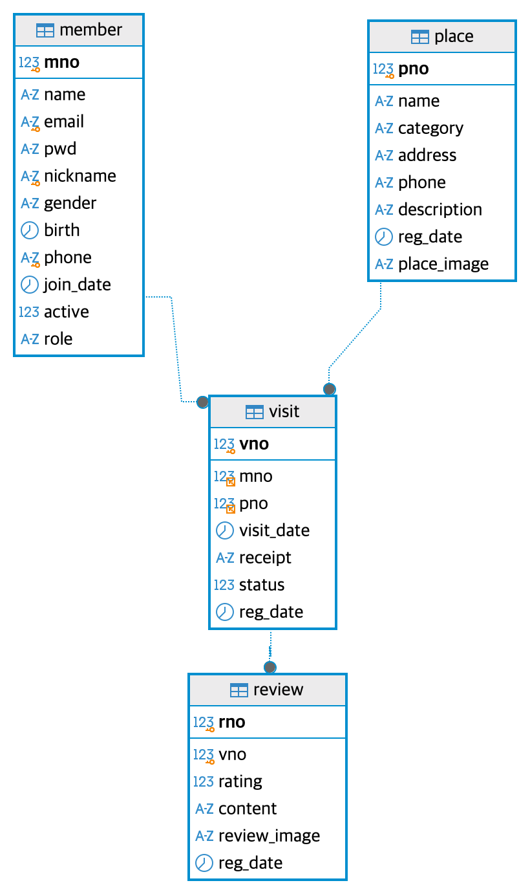

# FoodReview

방문 인증을 승인받은 회원만 리뷰를 작성할 수 있는 맛집·카페 리뷰 서비스입니다.

개인 프로젝트 | 백엔드 중심 웹 애플리케이션

## 1. 프로젝트 소개

백엔드 개발자 취업을 준비하며 배운 Spring Boot, MyBatis, MySQL을 활용해 구현했습니다. 단순한 게시판 CRUD에서 그치지 않고, 방문 인증·관리자 승인·리뷰 작성 자격처럼 기능끼리 연결된 규칙을 가진 주제를 골랐습니다.

회원이 영수증 이미지를 올려 방문 인증을 신청하면 관리자가 승인 또는 거절하고, 승인된 방문에 대해서만 리뷰를 쓸 수 있습니다.

### 핵심 규칙

- 관리자가 승인한 본인의 방문 기록으로만 리뷰 작성
- 방문 인증 1건당 리뷰 최대 1개
- 본인이 작성한 리뷰만 수정·삭제
- 관리자 기능은 관리자 권한을 가진 회원만 이용

### 이용 흐름

1. 회원가입 및 로그인
2. 가게 선택, 영수증 이미지 업로드, 방문 인증 신청
3. 관리자가 방문 인증 승인 또는 거절
4. 승인된 방문 기록으로 리뷰 작성
5. 리뷰 조회·검색·수정·삭제

## 2. 기술 스택

| 구분 | 기술 |
| --- | --- |
| Language | Java 17 |
| Framework | Spring Boot, Spring MVC |
| Database | MySQL 8 |
| Persistence | MyBatis |
| Template Engine | Thymeleaf |
| Frontend | HTML, CSS, JavaScript |
| Build Tool | Gradle |
| Test | JUnit 5, Mockito |
| Version Control | Git, GitHub |

## 3. 주요 기능

- **회원:** 회원가입, 로그인·로그아웃, 회원정보 수정
- **방문 인증:** 영수증 이미지와 함께 신청, 대기·승인·거절 상태 관리, 본인의 인증 내역 조회
- **리뷰:** 승인된 방문에 대한 작성, 목록·상세 조회, 키워드 검색, 별점 필터, 페이징(10개씩), 본인 리뷰 수정·삭제
- **관리자:** 방문 인증 승인·거절, 영수증 이미지 확인, 회원 목록 조회 및 활성 상태 관리

## 4. 주요 구현 내용

### 4-1. 리뷰 작성 자격 검증

로그인했다는 이유만으로 리뷰를 쓸 수 있게 하지 않고, 로그인한 회원 번호, 방문 인증 번호, 승인 상태를 함께 확인합니다. 리뷰 수정·삭제 때도 기존 리뷰가 본인의 것인지 확인합니다.

### 4-2. 중복 리뷰 방지

방문 인증 1건에 리뷰가 하나만 생기도록 두 곳에서 막았습니다.
서비스에서 중복 여부를 먼저 확인하고, 데이터베이스에서도 UNIQUE 제약조건으로 중복 저장을 방지하도록 구성했습니다.

- 서비스에서 등록 전에 해당 방문의 리뷰가 있는지 조회
- `review.vno` 컬럼에 UNIQUE 제약조건 적용

중복 등록을 요청하면 HTTP 409를 반환합니다. 실제 MySQL에서 중복 요청 시 409가 반환되고 리뷰가 두 번 저장되지 않는 것을 확인했습니다.

### 4-3. 방문 인증 상태 관리

| 상태값 | 의미 |
| --- | --- |
| 0 | 승인 대기 |
| 1 | 승인 |
| 2 | 거절 |

승인·거절은 상태가 승인 대기인 기록에 대해서만 UPDATE가 실행되도록 조건을 걸었습니다. 이미 처리됐거나 없는 방문 기록이면 변경된 행이 없으므로 관리자 API는 HTTP 409를 반환합니다.

### 4-4. 인증·인가

- 비밀번호는 BCrypt로 해싱해 저장
- 세션 기반 로그인
- LoginInterceptor: 로그인 여부와 회원 활성 상태 확인 (비활성 회원은 세션 무효화)
- AdminInterceptor: DB의 최신 회원 정보로 관리자 권한 확인

### 4-5. 이미지 파일 관리

영수증과 리뷰 이미지는 서버의 로컬 디렉터리에 저장하고, DB에는 파일명을 저장합니다.

- 파일 크기 5MB 제한
- 확장자와 파일 헤더 검사
- UUID 기반 파일명 생성
- 리뷰 이미지를 교체하거나 삭제할 때 기존 파일 삭제
- 리뷰 DB 등록에 실패하면 새로 저장한 이미지 삭제

### 4-6. 검색·페이징

MyBatis로 키워드와 별점(1~5) 조건을 함께 적용해 조회하며, 한 번에 10개씩 가져옵니다.

## 5. 데이터베이스



| 테이블 | 설명 |
| --- | --- |
| member | 회원 정보 |
| place | 맛집·카페 정보 |
| visit | 방문 인증 정보 |
| review | 리뷰 정보 |

관계: member : visit = 1 : N, place : visit = 1 : N, visit : review = 1 : 0..1 (외래키로 연결)

초기 테이블 생성 SQL은 `database/schema.sql`에 있습니다.

## 6. REST API

| Method | URL | 설명 | 권한 | 주요 응답 코드 |
| --- | --- | --- | --- | --- |
| GET | /api/reviews | 리뷰 검색·페이징 조회 | 전체 | 200 |
| POST | /api/reviews | 리뷰 등록 | 로그인 회원 | 201, 401, 409(중복) |
| PATCH | /api/admin/visits/{vno}/approve | 방문 인증 승인 | 관리자 | 200, 409(이미 처리됨 또는 없음) |
| PATCH | /api/admin/visits/{vno}/reject | 방문 인증 거절 | 관리자 | 200, 409(이미 처리됨 또는 없음) |

요청 예시

```http
GET /api/reviews?keyword=행복카페&rating=5&page=1
```

- keyword: 검색어
- rating: 별점 (1~5)
- page: 페이지 번호

## 7. 테스트 및 검증

**자동화 테스트 (JUnit 5, Mockito)**

- 관리자 방문 인증 승인·거절 성공·실패
- 리뷰 REST API 요청·응답
- 로그인 인터셉터

**실제 MySQL 연동 확인**

- 리뷰 등록 및 DB 저장
- 중복 리뷰 등록 시 409 응답과 중복 저장 방지
- 페이징, 키워드 검색, 별점 필터, 검색어와 별점 복합 필터
- 신규 DB에서 테이블 생성 스크립트 실행

## 8. 한계 및 앞으로 할 일

현재 로컬 환경에서만 개발하고 검증했습니다.

- 서버 배포 및 배포 환경 검증 예정
- 동시 요청 테스트는 하지 않았습니다.
- 파일 시스템 오류 상황은 실제로 재현해 검증하지 않았습니다.
- 자동화 테스트 범위 확대 예정

## 9. 실행 방법

<details>
<summary>펼쳐서 보기</summary>

### 실행 환경

Java 17, MySQL 8, Git

### 1) 프로젝트 다운로드

```bash
git clone https://github.com/ahyun00/foodreview.git
cd foodreview
```

비공개 저장소인 경우 접근 권한이 필요합니다.

### 2) 데이터베이스 생성

MySQL에 연결해 `database/schema.sql`을 실행합니다. 신규 DB 초기화용이므로 기존 테이블이 있는 환경에서는 다시 실행하지 않습니다.

### 3) 데이터베이스 연결 설정

`src/main/resources/application.properties` 파일을 만들어 아래처럼 설정합니다.

```properties
spring.application.name=foodreview

spring.datasource.url=jdbc:mysql://localhost:3306/foodreview
spring.datasource.username=YOUR_DB_USERNAME
spring.datasource.password=YOUR_DB_PASSWORD

mybatis.mapper-locations=classpath:mapper/**/*.xml
mybatis.configuration.map-underscore-to-camel-case=true

spring.servlet.multipart.max-file-size=5MB
spring.servlet.multipart.max-request-size=10MB
```

`YOUR_DB_USERNAME`, `YOUR_DB_PASSWORD`는 본인의 MySQL 접속 정보로 바꿉니다. 실제 접속 정보는 GitHub에 올리지 않습니다.

### 4) 실행

```bash
bash gradlew bootRun
```

브라우저에서 http://localhost:8080 으로 접속합니다. 테스트는 `bash gradlew test`로 실행합니다.

### 5) 관리자 계정 설정

회원가입 후 해당 계정의 권한을 ADMIN으로 바꾸고 다시 로그인합니다.

```sql
UPDATE foodreview.member
SET role = 'ADMIN'
WHERE email = 'admin@example.com';
```
이메일은 직접 가입한 테스트 계정의 이메일로 변경합니다.

### 6) 가게 테스트 데이터 등록

방문 인증을 신청하려면 가게 데이터가 필요합니다.

```sql
INSERT INTO foodreview.place
    (name, category, address, phone, description)
VALUES
    ('테스트카페', '카페', '테스트 주소',
     '000-0000-0000', '기능 검증용 가게');
```

### 7) 이미지 저장 경로

실행 디렉터리 기준으로 `uploads/receipts/`(영수증), `uploads/reviews/`(리뷰)에 저장되며, 업로드된 이미지는 GitHub에 포함하지 않습니다.

</details>